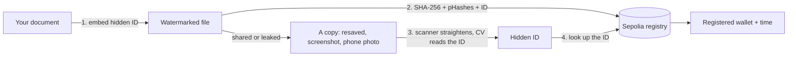

# DocuMark

**Hide a traceable ID in your documents, prove when you registered them on Ethereum, and find the owner of any copy, even a phone photo of a screen.**

DocuMark is a learning project that combines computer vision and a smart contract. It watermarks PDFs and images with an invisible ID, scans paper pages from a phone camera, and records tamper-evident fingerprints on the Ethereum Sepolia test network. Everything runs locally with no account, and files never leave your server.

> **Testnet only.** The contract is a learning project and is not audited. Do not use real funds or treat a registration as legal proof of authorship (see [Limitations](#limitations)).

## Contents

- [What it does](#what-it-does)
- [How it works](#how-it-works)
- [Quick start](#quick-start)
- [Using the app](#using-the-app)
- [Project layout](#project-layout)
- [Technical details](#technical-details)
- [API](#api)
- [Configuration](#configuration)
- [Testing](#testing)
- [Privacy and security](#privacy-and-security)
- [Limitations](#limitations)
- [Acknowledgements](#acknowledgements)

## What it does

| Tool | What you get |
| --- | --- |
| **Add watermark** | Embeds a random 64-bit hidden ID in the page brightness. Optionally adds a visible circular seal with your name. |
| **Scan document** | Turns up to 20 phone photos into a clean PDF: automatic edge detection, manual corner adjustment, rotation, five filters, page reordering. |
| **Inspect file** | Shows the SHA-256 and per-page perceptual hash (pHash) of a PDF or image. |
| **Sepolia proof** | Registers a file's fingerprint on Ethereum Sepolia (commit-reveal), checks existing records, finds visually similar documents, and signs a shareable proof certificate. |
| **Find owner** | Reads the hidden ID from any copy (resaved PDF, screenshot, phone photo) and looks up the registered owner on-chain. |

## How it works



1. **Embed.** A random 64-bit ID is hidden in the page pixels. You cannot see it, but computer vision can read it back.
2. **Register.** You register the exact downloaded file. The contract stores its SHA-256, a pHash root, the page count, the hidden ID, your wallet and the time. Registration is **commit-reveal**: a hidden commitment first, the reveal second, so nobody watching the network can copy your hash and register it before you.
3. **Recover.** Someone has a copy. A resaved or photographed copy has a different SHA-256, so an exact lookup misses it. DocuMark straightens the photo, extracts the hidden ID and finds the original record.
4. **Verify.** The result shows which wallet registered the original and when. You can also download a signed proof certificate that anyone can verify without a wallet.

The ID is stored on-chain, not the watermark itself. Embedding a file's own hash is impossible because embedding changes the file and therefore its hash, so a random ID links the copy to the record.

## Quick start

### Docker

```bash
docker build -t documark --build-arg VITE_SEPOLIA_REGISTRY_ADDRESS=<your registry address> .
docker run --rm -p 8000:8000 documark
```

Open <http://localhost:8000>. The registry address is optional and can also be pasted in the app. Wallets such as MetaMask need `localhost` or HTTPS, so a deployed site must use HTTPS.

### Local development (Windows)

Requirements: Python 3.12+, Node.js 22+, and a browser wallet such as MetaMask for the blockchain features.

```powershell
npm.cmd install
npm.cmd run setup      # creates .venv and installs requirements.txt
npm.cmd run dev        # starts the API (port 8765) and the Vite frontend (port 5173)
```

Open <http://127.0.0.1:5173>. Use `npm` instead of `npm.cmd` in Command Prompt or on macOS and Linux. Frontend and backend changes reload automatically.

**Phone camera.** Put the phone and computer on the same Wi-Fi, start `npm.cmd run dev`, and open the **Network** URL that Vite prints (for example `http://192.168.1.20:5173`). If it does not open, allow Node.js through the firewall on the private network. Scanning works over plain HTTP; wallets do not, so use the computer for blockchain steps.

## Using the app

### Watermark a document

1. Open **Add watermark** and choose a PDF or image.
2. Leave **Hidden ID watermark** on. Optionally tick **Also add a visible seal** and set the name, ink, opacity and size.
3. Download the file. The page shows its hidden ID.

### Register it on Sepolia

1. In MetaMask, switch to **Sepolia** and get free test ETH from a faucet.
2. Click **Register proof →**, or open **Sepolia proof** and upload the downloaded file.
3. First time only: click **Deploy test registry** and confirm. The address is saved in the browser (set `VITE_SEPOLIA_REGISTRY_ADDRESS` to share it).
4. Click **Register exact hash** and confirm **two** wallet transactions (commit, then reveal). A progress tracker shows each step with Etherscan links.
5. Optional: enter a creator name and click **Sign & download proof certificate**.

Register the exact bytes you will share. Re-saving a file changes its SHA-256.

### Trace a copy

1. Open **Find owner** and upload the copy (PDF, image, screenshot or phone photo).
2. For a phone photo, show the whole page on a darker background so the scanner can find its edges.
3. DocuMark reads the hidden ID and shows the registered wallet, the registration time and a transaction link. No wallet is needed.

### Scan paper pages

1. Open **Scan document** and tap **Take page photo with phone camera** (or add files).
2. Review each page: drag the four crop corners, rotate, choose a filter (Original, Auto enhance, Bright, Grayscale, Black & white) and reorder.
3. Save a multi-page PDF, or a JPG for a single page. **Add watermark to scanned PDF** carries the pages into the watermark tool.

## Project layout

```
backend/
  app/
    main.py            FastAPI app and all endpoints
    cv/
      invisible.py     hidden 64-bit watermark (DCT) and extraction
      visible.py       circular seal rendering and blending
      scanner.py       edge detection, perspective correction, filters, seal detector
      hashing.py       SHA-256, pHash, Hamming distance, pHash root
      io_pdf.py        PDF <-> pixel arrays
  tests/               pytest suites
contracts/
  DocumentRegistry.sol commit-reveal registry
  test/                local-EVM contract test
frontend/              Vite app: app.js (tools), chain.js (wallet and Sepolia)
samples/               generator for synthetic test documents
scripts/               dev server, setup, contract compiler
Dockerfile             one-container build (API + built frontend)
```

## Technical details

### Hidden watermark

The core is in [`backend/app/cv/invisible.py`](backend/app/cv/invisible.py).

- **Coding.** The 64-bit ID plus a CRC-16 gives 80 coded bits. Each page is resized to a fixed 256x256 grid so the mark survives rescaling.
- **Embedding.** Each bit is repeated across 8x8 blocks chosen by a fixed shuffle. A bit is the sign of the difference between DCT coefficients (1,3) and (3,1) of the brightness channel. Only the brightness *change* is computed on the grid and scaled back onto the page, so resolution and color are kept.
- **Strength.** About 3 grey levels at most about 7, plus 3 levels of headroom so white paper does not clip the mark. On very plain white pages a faint texture can be visible up close.
- **Extraction.** Votes are summed per bit across all blocks and four rotations. The CRC can repair up to two weak bits. A result is reported only if the CRC matches and the signal is clearly above what unmarked pages produce.
- **Phone photos.** The scanner finds the page quadrilateral with OpenCV, applies a perspective transform, and extraction runs on the straightened page.

Measured on the generated samples:

| Test | Result |
| --- | --- |
| JPEG quality 50, half-size copy, 90-degree rotation | ID recovered |
| Simulated phone photo (perspective, blur, noise, JPEG 85) after straightening | 150 of 150 random IDs recovered |
| Unmarked pages and random noise | 0 false detections in 1,200 readings |

These are simulations, not real camera tests, so real phone shots may do worse.

### Fingerprints and similarity

- **SHA-256** identifies an exact file. Any change, even re-saving, produces a different hash.
- **pHash** reduces a page to its low-frequency DCT structure as a 64-bit pattern, so it stays close after compression. Pages are compared by Hamming distance.
- **pHash root** is the SHA-256 of the ordered concatenation of page pHashes. The contract recomputes it from the submitted per-page hashes.
- **Similarity search.** **Check Sepolia registry** scans the registry's events and flags documents where at least 60% of pages are within 10 of 64 bits of yours, with the earlier registrant and transaction. Registering something similar to another wallet's record asks for confirmation first.

### Visible seal

A centered circular seal with double rings, your name on the upper arc and initials in the middle. On images it is alpha blended as `(1-a)P + aW` (default opacity 0.18, size 35% of the shorter side). On PDFs it is inserted as a transparent image over each page, so selectable text is preserved.

### Smart contract

[`DocumentRegistry.sol`](contracts/DocumentRegistry.sol) (Solidity 0.8.37) on Ethereum Sepolia (chain ID `11155111`):

- `commit(bytes32 commitment)`: stores `keccak256(fileHash, watermarkId, sender, salt)`. Nothing readable goes on-chain.
- `register(fileHash, salt, phashRoot, pageCount, pageHashes, watermarkId)`: in a later block, reveals the hash. It checks that the commitment belongs to the sender, that the page hashes match the root, that the file is not already registered, and that the watermark ID is not linked to another file. The record keeps the **commit time**.
- Stored per record: registrar wallet, commit timestamp, page count, pHash root, and a `watermarkId -> fileHash` mapping. The per-page pHashes are emitted in the event for off-chain similarity search.
- No file, name or personal data is stored. Records are permanent and cannot be edited.

### Proof certificate

A JSON file with the file hash, hidden ID, registry, transaction, block time and a free wallet signature over a fixed claim text, plus an optional creator name that stays off-chain. **Verify a proof certificate** checks that the signed text matches, the signature came from the registrar, and the on-chain record matches. It does not need a wallet.

## API

All endpoints are under `/api` and process files in memory.

| Method | Path | Purpose |
| --- | --- | --- |
| `GET` | `/api/health` | Liveness check |
| `GET` | `/api/seal-preview` | Preview image of the visible seal |
| `POST` | `/api/watermark` | Add a hidden ID and/or visible seal (`hidden`, `visible`, `text`, `opacity`, `color`, `size`). The hidden ID is returned in the `X-Watermark-Id` header. |
| `POST` | `/api/extract` | Read a hidden ID from a PDF, image or photo |
| `POST` | `/api/inspect` | SHA-256, pHashes, pHash root and any hidden ID |
| `POST` | `/api/scan` | Edge detection, sharpness and seal check for a page |
| `POST` | `/api/scan-render` | Render one photo with crop, filter and rotation |
| `POST` | `/api/scan-batch` | Combine up to 20 photos into one PDF |
| `POST` | `/api/scan-export` | Straightened PNG of a photo |

Limits: 20 MB per file, 60 MB per scan batch, 20 PDF pages, 25 megapixels per image.

## Configuration

Copy `.env.example` to `.env` only if you need these. `VITE_` values are public and compiled into the frontend, so never put keys or mnemonics here.

| Variable | Purpose | Default |
| --- | --- | --- |
| `VITE_SEPOLIA_REGISTRY_ADDRESS` | Registry address shared by all browsers | none (paste in the app or deploy) |
| `VITE_SEPOLIA_RPC_URL` | Read-only Sepolia RPC for lookups | `https://ethereum-sepolia-rpc.publicnode.com` |

## Testing

```powershell
.\.venv\Scripts\python.exe -m samples.generate    # create the synthetic sample documents
.\.venv\Scripts\python.exe -m pytest -q -s        # backend: CV, scanner, watermark, API
npm.cmd run contract:test                         # contract on a local Hardhat EVM
```

The backend suite covers PSNR/SSIM and pHash stability, the scanner, the hidden watermark (faintness, JPEG, resize, rotation, simulated phone photos, false positives) and every API flow. The contract test covers commit-reveal, front-running protection, duplicate files and IDs, and the pHash-root check. Samples are synthetic and contain no personal data.

## Privacy and security

- Files are processed in memory by your own server and returned as downloads. Nothing is uploaded elsewhere.
- Only fingerprints go on-chain, never the file, names or personal details.
- The server never touches a private key. Deployment and registration are signed in the browser wallet.
- The upload API enforces file type, size, image pixel count and PDF page limits, and rejects disguised files.
- The Docker image runs as a non-root user.

## Limitations

- **A registration is not proof of authorship.** It proves only that a wallet submitted a fingerprint at a certain time. Someone who already holds your exact file can register it first (commit-reveal stops mempool copying, not that), so register before you share. Keep your originals and drafts as evidence.
- **The hidden mark is for tracing copies, not for resisting removal.** Heavy cropping, strong filters, very small images, or a raw photo without visible page edges can destroy it. The shuffle key is public.
- **PDFs with a hidden ID become image-based.** They are rebuilt from 150-dpi page renders, so text is no longer selectable. The visible seal alone keeps selectable text.
- **Similarity is evidence, not proof.** The earlier record is the stronger one.
- **The seal detector is a heuristic** for the centered DocuMark-style seal, not a general watermark detector.
- **Testnet only, not audited.** Redeploying the contract creates a new registry; records on an older registry stay there.

## Acknowledgements

The interface adapts the tool-card and upload-workspace pattern of [iLovePDF](https://www.ilovepdf.com/), with DocuMark branding and copy. The scan workflow follows the capabilities described on [CamScanner's developer page](https://dev.camscanner.com/?language=en-us) (automatic crop, manual adjustment, enhancement, PDF/JPG output) as an independent local implementation. It includes none of CamScanner's proprietary AI, OCR or cloud features.

## License

No license has been chosen yet. Until one is added, all rights are reserved by the author.
